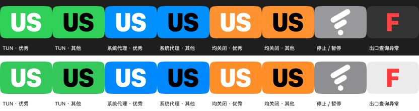

# Klash

[简体中文](README_zh_CN.md)

Klash, formerly Flash, is an unofficial derivative of [FlClash](https://github.com/chen08209/FlClash), maintained by CodeAIX. It preserves the upstream Core, profiles, subscriptions, rules and proxy controls, and adds macOS menu-bar exit monitoring. Klash does not provide proxy servers or subscriptions. The original GPL-3.0 license and upstream credits are retained; see [KLASH-NOTICE.md](KLASH-NOTICE.md).

## Download and migration

Download from [Klash Releases](https://github.com/CodeAIX/Klash/releases/latest): **arm64** for Apple Silicon, **x86_64** for Intel. Drag **Klash.app** from the DMG into Applications. Packages are ad-hoc signed and not notarized. Each binary includes its exact source archive with pinned Core/prism_ui, revision record and SHA256SUMS.

Klash 1.9.3 revision 3 uses build **2026110601** and bundle ID **com.codeaix.klash**. Its data directory and permission identity are separate. Export a local backup from Flash, stop Flash before switching network clients, then restore the backup in Klash. No active database is automatically copied and no old data is overwritten. Select the monitored target again if needed. This release does not automatically replace your installed Flash. Historical Flash releases and their original filenames remain available.

New WebDAV backups use **/Klash/&lt;filename&gt;**, normally backup.zip. Restore tries /Klash, /Flash, then /FlClash, keeping the same filename and configured server base path. Only HTTP 404/409 advances to the next path; authentication and other errors remain errors. Old backup files are read without modifying or deleting them. A successful connectivity test does not prove that a backup exists.

## Status legend

The approved white-tile, emerald-to-mint application icon is unchanged. Its original macOS corner curvature, margins and shadow are preserved. Artwork and generation instructions are in [klash/branding](klash/branding).

The menu-bar badge remains 26 × 18 pt with soft continuous corners and heavy country text. **Background shows entry configuration; text color shows IP quality.**

| Background or symbol | Meaning |
| --- | --- |
| Green | TUN configured on, taking priority over system proxy |
| Blue | TUN off, system proxy configured on |
| Orange | Both entry modes configured off |
| Gray with upstream-style logo | Core stopped or paused; country hidden |
| Neutral with red F | Exit lookup failed; F remains the failure indicator |

| Country text | Meaning |
| --- | --- |
| White | Built-in rating for this IP is excellent, IpQualityLevel.good |
| Black | Other, unknown, loading or failed quality lookup |
| -- | Country unknown |

Green/white US means TUN enabled, a US exit and excellent quality. Blue/black JP means system proxy only, a Japanese exit and other/unknown quality. A lookup may succeed with both entry modes off; it does not prove that every application uses this route. Residential, mobile and business IPs are usually good; Tor/abuse flags lower the rating and hosting IPs are not good. An old-IP result cannot turn a new IP white. Stopped/paused takes priority, followed by lookup failure and then normal country rendering.

Revision 3 prepares finite glyph paths outside the drawing callback. Redraw fills paths rather than performing NSString text layout, bypassing the observed CoreText attributed-text crash chain. Weight and baseline are calibrated against the previous 12.5 pt Heavy renderer; missing glyph preparation falls back to the visible logo. Only A–Z and the hyphen are cached. Rendering stress tests do not replace long-running sleep/wake or display-switch acceptance.

## Independent monitor controls

Use the independent ◎ beside a group or node, just before its delay. The current target has a persistent filled marker; other buttons appear on the highlighted row. The left ✓ still represents proxy selection. Clicking a node name keeps the original switch action; group arrows open their submenus. ◎ changes only the monitored target.

Select a manual group, an automatic group appearing inside it, or a concrete node. Groups follow their current actual exit; a fixed node remains the target when another group changes. Monitoring options at the bottom show the target, restore rule routing and refresh exit IP/quality. Option+Return on a highlighted target and named accessibility actions are supported.

Selection is saved locally. Exit IP refreshes every 60 seconds while running and when the target changes. Quality is cached by IP for three days; manual refresh invalidates it. A removed target remains unavailable instead of choosing another exit. A load-balancing group's badge represents that particular probe, not all traffic or AI-service availability.

## Upstream and independent overlay

This revision is based on **FlClash v0.9.3**. Klash retains the application artwork, badge semantics, background monitoring, stable channel and file-picker entitlements. Private upstream module, Core executable and IPC names remain compatibility details rather than product identity. Windows and Android are not Klash distribution targets.

Version mapping adds one to the upstream major and keeps minor/patch: 0.9.3 → 1.9.3, 0.10.0 → 1.10.0. Same-upstream revisions use build metadata such as v1.9.3+2026110601; the app short version remains 1.9.3. See [klash/upstream.json](klash/upstream.json).

The [independent patch](klash/runtime.patch) and explicit file list reconstruct customization from the pinned upstream. Daily stable-release checks stop on conflicts. Compatible candidates require analysis, regression tests, native menu/glyph checks and both macOS builds before merge/publication. Upstream changes may need manual adaptation. Historical workflow filenames remain stable dispatch IDs; their displayed names and artifacts use Klash.

## Build

Current CI pins Flutter 3.47.6, Go 1.27.1 and Xcode 26 SDK; build hooks also require Rust.

~~~sh
git clone --recursive https://github.com/CodeAIX/Klash.git
cd Klash
flutter pub get
flutter build macos --release --dart-define=KLASH_STATUS_ICON=true --dart-define=APP_ENV=stable
~~~

Use --dart-define=SAFE_MODE=true for host development so the test client does not take over the current network. KLASH_STATUS_ICON=false restores upstream template tray icons. See [overlay maintenance](klash/README.md).
