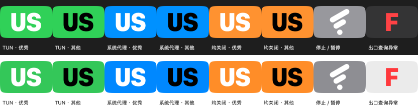

# Flash


Flash 是基于 [FlClash](https://github.com/chen08209/FlClash) 的非官方衍生客户端，由 CodeAIX 维护。保留 FlClash 的代理内核、配置、订阅、规则、节点与原有交互，新增 macOS 状态栏可视化。Flash 不提供代理节点或订阅服务。

## 下载

从 [Flash Releases](https://github.com/CodeAIX/Flash/releases/latest) 下载 macOS 安装包：

- `arm64`：Apple Silicon（M 系列）。
- `x86_64`：Intel Mac。

打开 DMG，将 Flash 拖入 Applications。安装包采用 ad-hoc 签名，尚未经过 Apple 公证。每个版本附 SHA-256 校验、准确源码及内核子模块源码。

## Flash 特性

应用图标采用白底、翡翠绿到薄荷绿渐变，保留上游两条斜杠与圆点的图形结构，以及原版 macOS 底板的圆角曲率、边距与轻微投影。矢量源与生成方法见 [flash/branding](flash/branding)。

状态图标采用更柔和的圆角矩形，内嵌加大加粗的当前规则出口 IP 国家代码。**底色看代理入口，字色看 IP 质量**，两个维度分别判断。



图中上排为深色外观，下排为浅色外观；图标放大展示，实际大小为 26 × 18 pt。`US` 为美国出口示例，其他国家显示对应两位代码。

| 底色 / 符号 | TUN | 系统代理 | 含义 |
| --- | --- | --- | --- |
| 🟩 绿色 | 开启 | 开启或关闭 | TUN 已配置开启，显示优先级高于系统代理 |
| 🟦 蓝色 | 关闭 | 开启 | 仅系统代理已配置开启 |
| 🟧 橙色 | 关闭 | 关闭 | 两种代理入口均未配置开启；不代表出口查询必然失败 |
| 灰底原版风格符号 | — | — | 代理停止或暂停，隐藏国家代码 |
| 中性底红色 `F` | — | — | 运行期间出口查询异常，隐藏国家代码；与 IP 质量差不同 |

| 国家代码字色 | 判定 |
| --- | --- |
| 白色 | 当前出口 IP 的内嵌质量评级为“优秀”（`IpQualityLevel.good`） |
| 黑色 | 其他评级，以及未知、查询中或查询失败；不会把“尚未检测”当作优秀 |

例如：**绿底白字 US** = TUN 开启、美国出口、质量优秀；**蓝底黑字 JP** = 仅系统代理开启、日本出口、非优秀或尚未取得有效质量结果；**橙底白字 US** = 两种入口均关闭，但该次出口查询取得美国 IP 且评级优秀。字色不会改变底色。

“优秀”复用内嵌检测的规则：住宅、移动或企业类型通常为优秀，Tor / 滥用标记优先降低评级，机房类型不算优秀。查询只使用当前出口 IP 对应的有效结果；切换节点后不会沿用旧 IP 的白字。

显示优先级为：**停止 / 暂停 → 出口查询异常 → 运行状态的底色与国家代码**。国家未知显示 `--`，质量未知使用黑字。后台约每 60 秒刷新，出口变化也会触发更新，网络请求完成前可能短暂显示未知状态。

底色描述入口配置，国家代码描述该次规则出口查询，质量描述 IP 检测结果；它们不保证 TUN 实际接管所有流量，也不保证所有应用、规则或 AI 服务可用。

Flash 复用 FlClash 内核、出口与 IP 质量检测，不增加第二个代理内核。运行期间保持后台状态监测，定期刷新；切换出口后不会沿用前一个 IP 的质量结果。保留原有托盘菜单、节点操作与速度显示。

目前仅分发 macOS 版本。Windows 与 Android 的 Flash 品牌和状态显示适配尚未完成。

## 与 FlClash 的关系及版本

Flash 不是 FlClash 官方发行版。上游功能、核心实现及主要界面归功于 FlClash、mihomo 和各第三方项目；原版权和 [GPL-3.0 许可证](LICENSE) 保留，修改说明见 [FLASH-NOTICE.md](FLASH-NOTICE.md)。

Flash 版本按上游正式版的 major 加 1，minor、patch 保持一致：`0.9.1 → 1.9.1`、`0.9.2 → 1.9.2`、`0.10.0 → 1.10.0`。这不是 SemVer 的 `+` 构建元数据语法。对应上游版本、commit 与 Flash 版本记录在 [flash/upstream.json](flash/upstream.json)。

同一上游版本的 Flash 修复使用递增构建号和独立修订标签，例如 `v1.9.1+2026102302`；应用版本仍为 `1.9.1`。原发布标签和安装包保留，下一次上游更新恢复正常版本映射。

## 备份与恢复

Flash 新远程备份写入 WebDAV 地址下的 `/Flash/<文件名>`，默认 `backup.zip`。恢复先读取此路径；仅当返回 404 或 409 时，尝试只读获取 `/FlClash/<同一文件名>`，以兼容原客户端备份。Flash 路径存在时优先使用，不覆盖或删除旧客户端备份。连通性检查成功仅表示服务器响应，不代表备份文件已存在或允许下载。

旧版 1.9.1 的打包步骤丢失文件选择权限，导致本地保存报 `ENTITLEMENT_REQUIRED_WRITE`、恢复时无法打开选择窗口；修订版恢复签名中的文件读写权限，并增加打包后校验。正式构建指定 `APP_ENV=stable`，去除默认 `pre` 标识。

## FlClash 0.9.2 适配

Flash 1.9.2 基于 FlClash v0.9.2，继承其 IP 质量三天缓存、内核和界面更新，保留 Flash 的绿色应用图标、状态栏颜色与国家码规则，以及本地/WebDAV 备份修复。Flash 国家码徽标固定使用状态颜色，因此不展示上游的“单色图标”开关；其他托盘菜单保留。

## 独立定制与自动更新

Flash 定制以 [flash/runtime.patch](flash/runtime.patch) 和文件清单维护，文档、品牌声明及工作流作为覆盖文件保留。更新器每天检查上游正式 Release，排除预发布；从固定 tag 重建源码并尝试应用定制补丁。

补丁冲突即停止，不丢弃 Flash 改动。兼容时创建候选分支和 PR，显式触发检查、测试及 macOS 双架构构建；全部通过才合并并发布对应版本。构建成功不代替网络行为的人工验收。上游若修改托盘、provider、平台身份或工具链，仍可能需要人工适配。

## 从源码构建

使用源码包内固定版本的 Flutter、Go、Rust 要求；本次基线为 Flutter 3.47.6、Go 1.27、Rust 1.99.0，以及 Xcode 26 SDK 或兼容更新版本。

```sh
git clone --recursive https://github.com/CodeAIX/Flash.git
cd Flash
flutter pub get
flutter build macos --release --dart-define=FLASH_STATUS_ICON=true --dart-define=APP_ENV=stable
```

本地调试请使用 `--dart-define=SAFE_MODE=true`，以免接管现有代理环境。使用 `--dart-define=FLASH_STATUS_ICON=false` 可回退原版模板托盘图标。
