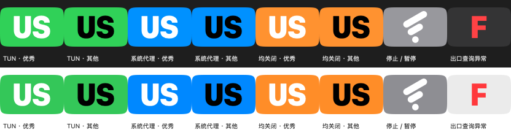

# Klash

[English](README.md)

Klash 原名 Flash，是 CodeAIX 维护的 [FlClash](https://github.com/chen08209/FlClash) 非官方衍生客户端。保留上游内核、配置、订阅、分流和节点操作，增加 macOS 状态栏出口监测。Klash 不提供节点或订阅服务。原 GPL-3.0 许可和上游署名保留，见 [KLASH-NOTICE.md](KLASH-NOTICE.md)。

## 下载与更名迁移

从 [Klash Releases](https://github.com/CodeAIX/Klash/releases/latest) 下载：Apple Silicon 选择 **arm64**，Intel 选择 **x86_64**。将 DMG 中的 **Klash.app** 拖入 Applications。采用 ad-hoc 签名，尚未公证；每个二进制包附准确对应源码、固定 Core/prism_ui 子模块源码、版本记录和 SHA256SUMS。

Klash 1.9.3 修订 3 的构建号为 **2026110601**，包标识为 **com.codeaix.klash**，使用独立的数据目录和权限身份。迁移时先在 Flash 导出本地备份，切换网络客户端前退出 Flash，再在 Klash 恢复备份。不会自动复制活动数据库或覆盖旧数据，监测目标可能需要重新选择。本版不会自动替换已安装的 Flash。历史 Flash Release 和原安装包文件名继续保留。

新的 WebDAV 备份写入 **/Klash/&lt;文件名&gt;**，默认 backup.zip。恢复按 /Klash、/Flash、/FlClash 顺序读取同一文件名，并保留服务器基础路径；仅在 HTTP 404/409 时回退，鉴权和其他错误直接保留。旧文件只读，不修改、不删除。连通性测试成功不代表备份文件已存在。

## 状态栏图例

保留白底、翡翠绿到薄荷绿渐变应用图标，以及原 macOS 底板的圆角曲率、边距和投影。图源和生成方法见 [klash/branding](klash/branding)。

状态栏徽标仍为 26 × 18 pt 柔和圆角矩形，国家码加大加粗。**底色看入口配置，字色看 IP 质量。**

| 底色或符号 | 含义 |
| --- | --- |
| 绿色 | TUN 已配置开启，优先于系统代理 |
| 蓝色 | TUN 关闭，仅系统代理已配置开启 |
| 橙色 | 两种入口均未配置开启 |
| 灰底原版风格 Logo | 内核停止或暂停，隐藏国家码 |
| 中性底红色 F | 出口查询失败；F 保留为故障标识 |

| 国家码字色或内容 | 含义 |
| --- | --- |
| 白色 | 此 IP 内嵌评级为优秀，IpQualityLevel.good |
| 黑色 | 其他、未知、查询中或查询失败 |
| -- | 国家未知 |

例如绿底白字 US 表示 TUN 开启、美国出口、质量优秀；蓝底黑字 JP 表示仅系统代理、日本出口、其他或未知质量。入口均关闭时单次查询仍可能成功，不代表所有应用使用同一出口。住宅、移动和企业类型通常为优秀，Tor/滥用标记优先降低评级，机房不算优秀。旧 IP 结果不会让新 IP 变白。显示优先级为停止/暂停、出口失败、正常国家码。

修订 3 在绘制回调外预先准备有限字符的字形路径，重绘只填充路径，不再执行 NSString 文字排版，绕开已观测到的 CoreText 崩溃链。按旧版 12.5pt Heavy 外观校准字重和基线，缺字准备失败显示可见 Logo。只缓存 A–Z 和短横线。绘制压力测试通过仍不能代替长期运行、睡眠唤醒和显示器切换验收。

## 独立监测按钮

在原版组或节点行、延迟数字左侧使用独立 ◎。当前目标实心标记常驻，其他按钮随行高亮出现；左侧 ✓ 仍表示代理选择。点击名称保持原版节点切换，组箭头照常展开，◎ 只设置监测对象。

支持手动组、其成员中的嵌套自动组和具体节点。选择组时跟随当前实际出口，选择具体节点则不受其他组切换影响。底部“监测选项”显示目标、恢复按分流规则，并可刷新出口和质量；支持高亮后 Option+Return 及命名无障碍操作。

目标本机保存，运行期间每 60 秒刷新出口，切换目标立即刷新；质量按 IP 缓存 3 天，手动刷新使缓存失效。目标消失时保持不可用，不静默切换。负载均衡组可能每次请求使用不同出口，图标仅代表该次探测，不代表所有流量或 AI 服务可用。

## 与上游的关系和独立补丁

本版基于 **FlClash v0.9.3**，保留绿色图标、徽标语义、后台监测、正式渠道和文件选择读写权限。上游内部模块、Core 可执行文件和 IPC 协议名继续作为兼容实现保留，不是产品身份。暂不发布 Klash 的 Windows 和 Android 版本。

版本为上游 major 加 1、minor/patch 不变：0.9.3 → 1.9.3、0.10.0 → 1.10.0。同一上游修订使用递增构建号，例如 v1.9.3+2026110601，应用短版本仍为 1.9.3。固定版本见 [klash/upstream.json](klash/upstream.json)。

[独立补丁](klash/runtime.patch)和显式文件清单从固定上游重建定制。每日检查正式上游，冲突即停止；兼容候选须通过分析、回归、原生菜单/字形测试和双架构构建才合并发布。上游改动仍可能需要人工适配。工作流历史文件名保留以维持调度身份，显示名称和产物已使用 Klash。

## 构建

当前 CI 固定 Flutter 3.47.6、Go 1.27.1、Xcode 26 SDK，构建钩子还需要 Rust。

~~~sh
git clone --recursive https://github.com/CodeAIX/Klash.git
cd Klash
flutter pub get
flutter build macos --release --dart-define=KLASH_STATUS_ICON=true --dart-define=APP_ENV=stable
~~~

本机开发使用 --dart-define=SAFE_MODE=true，避免接管现用网络。KLASH_STATUS_ICON=false 可恢复上游模板托盘图标。详见[补丁维护说明](klash/README.md)。
